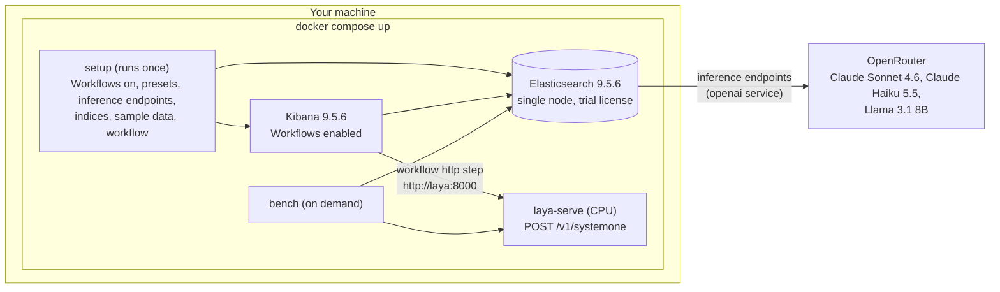
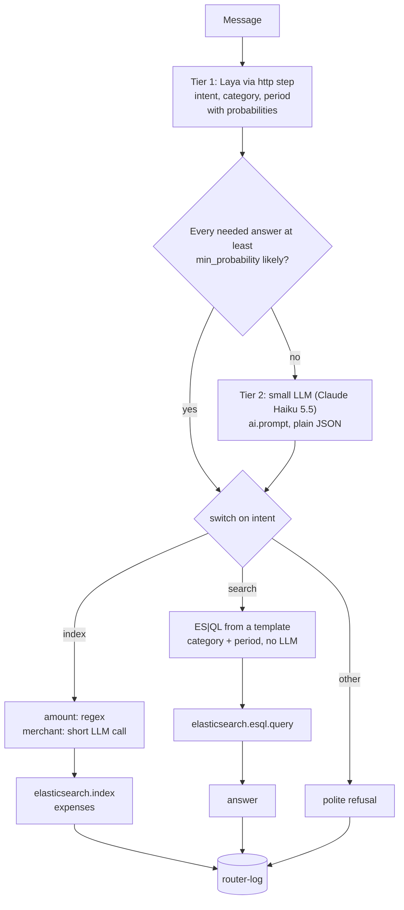

# Two-tier router on Elastic, local edition

A finance assistant that decides what a message means before any LLM is
involved. **Laya**, an open-source, non-generative decision model (Apache-2.0,
a Jev-compatible API), labels every message with probabilities. An LLM is
called only when Laya is not confident, or when free text has to be extracted.
An Elastic workflow does the routing, and Elasticsearch stores and answers.

| Message | Intent | What happens |
|---|---|---|
| "I paid $1,000 for coffee at Starbucks" | index | saved to the `expenses` index under `coffee` |
| "What are my payment expenses that happened last month?" | search | a templated ES\|QL query answers with the total |
| "Remind me to pay rent on Friday" | other | politely declined |

The repository also contains a benchmark that runs the same 200 labeled messages
through Laya, three LLMs and the router, and reports accuracy, consistency,
latency and cost per million decisions.

Everything runs locally with one command: Elasticsearch, Kibana, Laya and a
one-shot setup. The only external service is OpenRouter, for the LLMs.

## Quick start

Requires Docker with about 8 GB of memory for the stack.

```bash
cp .env.example .env     # set two passwords, an encryption key and OPENROUTER_API_KEY
docker compose up -d     # first start: about 10 minutes (images and Laya's 1.7 GB model)
docker compose logs -f setup
```

When setup prints **Ready**, open Kibana at http://localhost:5601 (user
`elastic`, the password from `.env`) and go to **Workflows → Finance router**.
Click **Run** and type a message.

Run the benchmark (about 15 minutes for all 200 messages and every classifier):

```bash
docker compose run --rm bench
cat results/report.md
```

## Architecture



The router workflow:



Every decision is written to `router-log` with who decided (`laya` or `llm`),
Laya's lowest probability and the answer.

## What is in the repository

| Path | Content |
|---|---|
| `docker-compose.yml` | The stack: `elasticsearch`, `init`, `kibana`, `laya`, `setup`, `bench` |
| `laya/Dockerfile` | `laya[serve]` 0.3.11 on CPU PyTorch |
| `tools/labels.py` | The label set (intents, categories, periods). Laya, the LLMs, the workflow and the benchmark all use it. |
| `tools/setup.py` | One-shot setup, safe to run again |
| `tools/workflows/finance-router.yaml` | The router workflow template |
| `tools/bench.py` | The benchmark |
| `data/messages.jsonl` | 200 labeled messages: 87 index, 82 search, 31 other, including 30 reworded twins |

## Configuration (.env)

| Variable | Meaning |
|---|---|
| `STACK_VERSION` | Elasticsearch and Kibana image version (9.5.6) |
| `ELASTIC_PASSWORD`, `KIBANA_PASSWORD` | Passwords for `elastic` and the internal `kibana_system` user |
| `KIBANA_ENCRYPTION_KEY` | 32+ random characters (`openssl rand -hex 32`) |
| `OPENROUTER_API_KEY` | LLM baselines, the router fallback and merchant extraction |
| `ROUTER_MIN_PROBABILITY` | Threshold below which the router asks the LLM (default 0.7) |
| `LAYA_HOURLY_USD` | What one machine running Laya costs per hour, for the cost model (default 0.10) |
| `ES_PORT`, `KIBANA_PORT`, `LAYA_PORT` | Host ports, if 9200, 5601 or 8000 are taken |

## The benchmark

`tools/bench.py` sends every message to every classifier with the same three
questions and the same option descriptions:

| Classifier | How it is called |
|---|---|
| `laya` | `POST http://laya:8000/v1/systemone`, one request with three choice questions |
| `sonnet`, `haiku`, `llama` | Elasticsearch `_inference/chat_completion/<id>/_stream` (the path a workflow uses), plain JSON answer, real token counts from the stream |
| `router@T` | Laya's labels when its probability is at least T, otherwise Haiku's. Computed from the runs above for T from 0.5 to 0.95 |

It reports, per classifier: accuracy for intent, category (index and search
messages) and period (search messages); **flip rate**, the share of reworded
twins that got a different answer; p50 and p95 latency; tokens; and **cost per
1M decisions**:

- LLMs: average tokens times the OpenRouter list price, read when the benchmark runs.
- Laya: `LAYA_HOURLY_USD` divided by measured throughput, plus the fixed cost of
  keeping one machine up (`LAYA_HOURLY_USD` x 730 hours). Laya costs money even
  when idle, so the report also gives the **break-even volume** per month
  against each LLM.

Results go to `results/report.md`, `results/summary.json`,
`results/per_message.csv` and the `bench-results` index (one document per
message and classifier) for ES|QL in Kibana.

## Things to know

- **License.** Workflows and the AI steps need a paid tier on self-managed
  Elasticsearch. The stack starts Elastic's self-generated 30-day trial. After
  30 days, run `docker compose down -v` and start again, or add a license.
- **Version.** Elastic announced 9.5.7, but its Docker images are not on
  `docker.elastic.co` yet (checked 2026-11-06). Set `STACK_VERSION=9.5.7` in
  `.env` once they are.
- **Without an OpenRouter key**, setup still builds everything and Laya still
  routes. The LLM fallback, merchant names and the LLM baselines are skipped
  with a warning. Fix the key, then `docker compose up setup`.
- **Option wording matters for Laya.** Laya is an encoder that matches words,
  so negation misleads it. Describing "other" as "neither records an expense
  nor asks about spending" sent 35 of 36 expense messages to "other". Short,
  positive descriptions ("save this purchase to my expenses") lifted intent
  accuracy from 42% to 75% on a 24-message sample. LLMs read either wording
  correctly. See `tools/labels.py`.
- **Laya on CPU in Docker** takes about 2.5 to 3 seconds per message for three
  questions on a 4-CPU Docker VM. Docker on macOS cannot use the Apple GPU. To
  measure Laya natively on a Mac, run it outside Docker
  (`pip install "laya[serve]"`, then `LAYA_DEVICE=mps LAYA_MODELS=english laya-serve`)
  and point the benchmark at it:
  `docker compose run --rm -e LAYA_URL=http://host.docker.internal:8000 bench`.
  Native Apple GPU speed has not been measured yet.
- **Ports** bind to 127.0.0.1 only. Change them in `.env` if they are taken.

## Stop and reset

```bash
docker compose down        # stop, keep data and the downloaded model
docker compose down -v     # stop and delete data, the trial and the model cache
```
