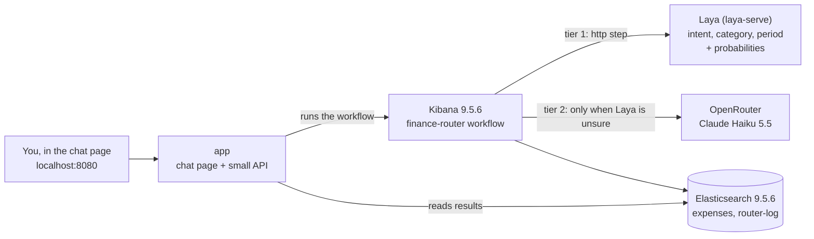
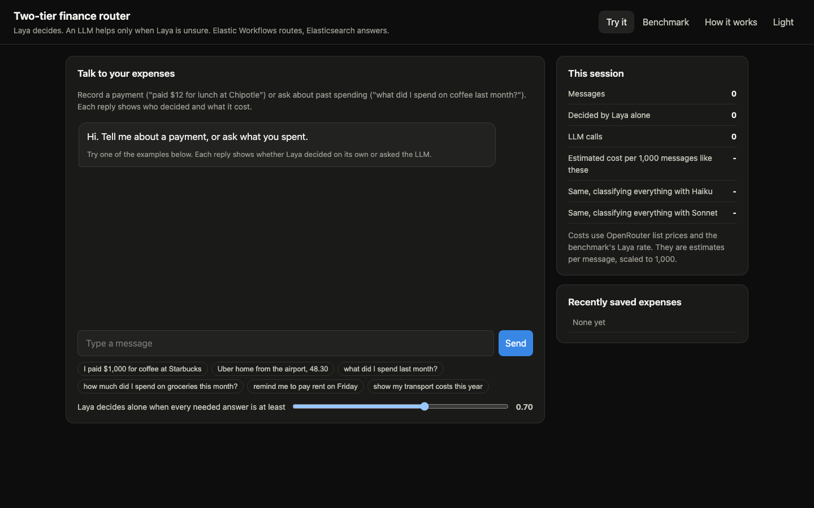
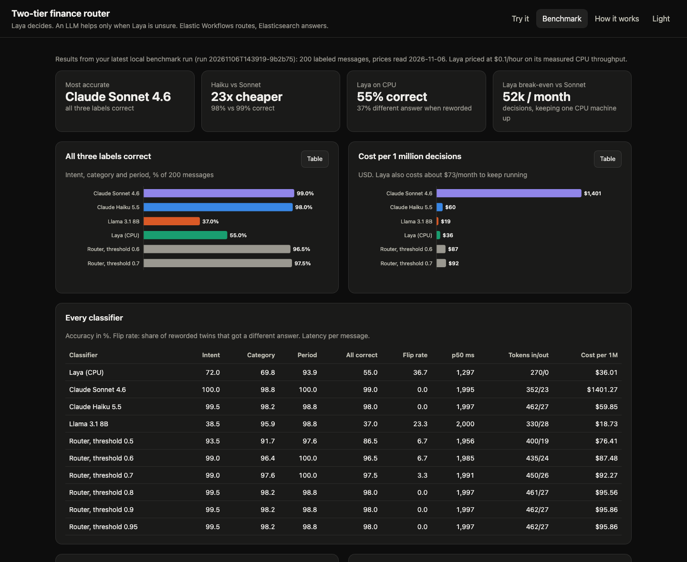
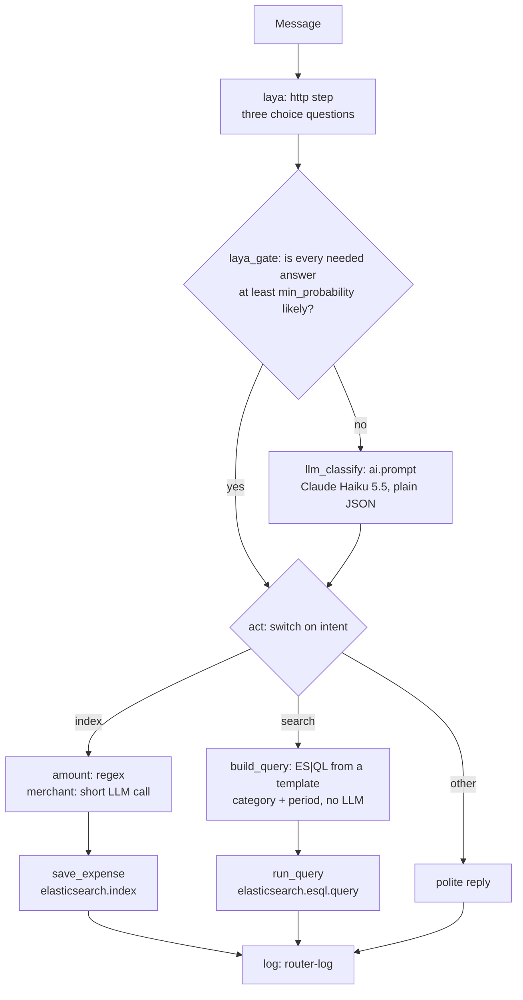

# Decide first, generate later: a two-tier router on Elastic Workflows

Most messages to a finance assistant are easy to classify. Is the user
recording a payment, or asking about past spending? Which category? Which
month? Sending every one of them to a large language model works, but you pay
for generation you do not need.

This tutorial builds a **two-tier router**:

- **Tier 1, decide:** [Laya](https://huggingface.co/convaiinnovations/laya), an
  open-source, non-generative decision model (Apache-2.0), labels every message
  and says how sure it is. No text is generated.
- **Tier 2, only when needed:** a small LLM (Claude Haiku 5.5) classifies the
  messages Laya is unsure about, and extracts the merchant name when an expense
  is saved.

An **Elastic workflow** does the routing and **Elasticsearch** stores the
expenses and answers the questions with ES|QL. A chat page lets anyone try it,
and a benchmark compares Laya, three LLMs and the router on 200 labeled
messages.

| You type | The router decides | What happens |
|---|---|---|
| "I paid $1,000 for coffee at Starbucks" | save, coffee | stored in the `expenses` index |
| "What are my payment expenses that happened last month?" | search, all categories, last month | an ES\|QL query answers with the total |
| "Remind me to pay rent on Friday" | something else | politely declined |

Everything runs on your machine with one command.



## What you need

- Docker (Docker Desktop on macOS and Windows) with about 8 GB of memory available.
- An [OpenRouter API key](https://openrouter.ai/settings/keys). A few dollars
  of credit is plenty: the full benchmark costs well under $1. Without a key,
  Laya still routes, but the LLM steps are skipped.
- About 5 GB of free disk for images and Laya's model.
- `bash` for `start.sh` (built in on macOS and Linux; use WSL or Git Bash on Windows).

## Step 1: Get the code

```bash
git clone https://github.com/Som23Git/two-tier-router-orchestration.git
cd two-tier-router-orchestration
```

## Step 2: Start everything with one command

```bash
./start.sh
```

The first time, `start.sh`:

1. creates `.env` with random passwords and an encryption key,
2. asks for your OpenRouter key (input is hidden),
3. picks free ports if 9200, 5601, 8080 or 8000 are already taken,
4. starts the stack and waits for the one-shot setup to finish,
5. opens the chat page.

The first start takes about 10 minutes: Docker pulls the Elastic images and
Laya downloads its 1.7 GB model. Later starts take under a minute.

At the end you see something like:

```
== Smoke test
[completed] 'I paid $4.50 for a flat white at Blue Bottle' -> intent=index category=coffee ... | Saved 4.50 USD at Blue Bottle under coffee.
[completed] 'how much did I spend on coffee last month?' -> intent=search ... decided_by=laya | You spent 101.02 USD on coffee (last month), 17 payments.

Chat page: http://localhost:8080
Kibana:    http://localhost:5601  (user elastic, password: ELASTIC_PASSWORD in .env)
```

<details>
<summary>Prefer plain Docker Compose?</summary>

```bash
cp .env.example .env    # fill in the two passwords, KIBANA_ENCRYPTION_KEY (openssl rand -hex 32) and OPENROUTER_API_KEY
docker compose up -d
docker compose logs -f setup   # wait for "Ready"
```
</details>

What is running:

| Service | What it does |
|---|---|
| `elasticsearch` | Single node with the free 30-day trial, which unlocks Workflows and the AI steps |
| `kibana` | Workflows UI and APIs |
| `laya` | `laya-serve` on CPU, the Jev-compatible `POST /v1/systemone` API |
| `setup` | Runs once: turns on Workflows, creates the OpenRouter presets and inference endpoints, the indices, 13 months of sample expenses, the benchmark messages and the `finance-router` workflow |
| `app` | The chat page and its API |
| `bench` | The benchmark, only when you run it |

## Step 3: Try it in the chat page

Open http://localhost:8080 (or the port `start.sh` printed).



Click an example or type your own message. Try both kinds:

- Record something: "Uber home from the airport, 48.30", "paid 12.50 for lunch at Chipotle"
- Ask something: "how much did I spend on groceries this month?", "what did I spend last week?"
- Something else: "remind me to pay rent on Friday", "set a budget of $300 for dining"

Every reply shows:

- **The answer.** Saved expenses appear under *Recently saved expenses*.
- **Who decided.** *Decided by Laya* means no LLM classified the message.
  *Laya unsure, LLM decided* means Laya's probability for at least one needed
  answer was below the threshold.
- **The three labels** with Laya's choice and probability for each.
- **LLM calls** with their tokens, the time taken, and the estimated cost per
  1,000 messages like this one.
- **Open in Kibana**, the workflow execution step by step.

Then move the **threshold slider**. At 0.5, Laya decides more messages alone,
so it is cheaper but makes more mistakes. At 0.9, almost everything goes to
the LLM. The **This session** panel compares what your messages cost with
classifying everything with Haiku or with Sonnet.

## Step 4: Look under the hood in Kibana

Open Kibana (http://localhost:5601, user `elastic`, password `ELASTIC_PASSWORD`
from `.env`).

**The workflow.** Go to **Workflows → Finance router (Laya first, LLM
fallback)**. The YAML is in `tools/workflows/finance-router.yaml`; setup fills in
the labels from `tools/labels.py`. Open **Executions** and click any run to see
each step's input and output: Laya's probabilities in `laya`, the decision in
`laya_gate`, the generated ES|QL in `build_query`.

**The routing log.** Every message is logged. In **Discover**, switch to ES|QL:

```esql
FROM router-log
| SORT @timestamp DESC
| KEEP @timestamp, text, intent, category, period, decided_by, laya_min_probability, answer
```

How often did Laya decide alone?

```esql
FROM router-log | STATS messages = COUNT(*) BY decided_by
```

**Your expenses:**

```esql
FROM expenses | WHERE source == "router" | SORT @timestamp DESC
```

## Step 5: The benchmark

The **Benchmark** tab in the chat page shows the results. Out of the box it
shows the snapshot in `data/benchmark-snapshot/`; after you run your own
benchmark it shows yours.



Results on the 200 labeled messages in `data/messages.jsonl` (2026-11-06):

| Classifier | All three labels correct | Different answer when reworded | Typical latency | Cost per 1M decisions |
|---|---|---|---|---|
| Claude Sonnet 4.6 | 99.0% | 0% | 2.0 s | $1,401 |
| Claude Haiku 5.5 | 98.0% | 0% | 2.0 s | $60 |
| Llama 3.1 8B | 37.0% | 23% | 2.0 s | $19 |
| Laya (CPU, Docker) | 55.0% | 37% | 1.3 s | $36, if the machine is busy all month |
| Router, threshold 0.6 | 96.5% | 7% | 2.0 s | $87 |
| Router, threshold 0.7 | 97.5% | 3% | 2.0 s | $92 |

What it tells you:

- **Against a large model, two tiers pay.** Haiku is as accurate as Sonnet for
  this task at 1/23 of the cost. One Laya machine costs about $73 a month
  ($0.10 x 730 hours), the price of about 52,000 Sonnet decisions, so below
  that volume it cannot pay for itself even if it answered every message alone.
- **Against a cheap small LLM, Laya on CPU does not pay here.** Laya is rarely
  confident (only 6% of messages reach 0.7 on every answer), so the router
  still asks the LLM for 86 to 94% of messages and pays for both.
- **The numbers are a worst case for Laya.** It ran on CPU inside a shared
  Docker VM at about 2,800 decisions per hour. On a GPU it is reported to be
  much faster, which would cut its cost per decision sharply.
- **Llama 3.1 8B** often answered with an option's description instead of its
  name ("save this purchase to my expenses" instead of `index`), which counts
  as wrong because a router could not use it.

Run it yourself (about 10 minutes, well under $1 of OpenRouter credit):

```bash
docker compose run --rm bench
cat results/report.md
```

Then reload the Benchmark tab. Options:

```bash
docker compose run --rm bench python bench.py --limit 40 --only laya,haiku
```

How the benchmark works:

| Measure | How |
|---|---|
| Accuracy | Intent on every message, category on index and search messages, period on search messages, and "all three correct" |
| Flip rate | 30 messages have a reworded twin with the same labels; the share answered differently |
| Latency | p50 and p95 per message, as seen by the caller |
| LLM cost | Average tokens per message (real counts from the Elasticsearch inference stream) times the OpenRouter list price, read when the benchmark runs |
| Laya cost | `LAYA_HOURLY_USD` divided by the measured throughput, which assumes the machine is busy all month. Separately, the monthly cost of keeping one machine up (`LAYA_HOURLY_USD` x 730 hours) divided by each LLM's cost per decision gives the break-even volume per month. These are two views of the same machine, not costs to add together |
| Router | Laya's labels when its probability is at least the threshold, otherwise Haiku's, for thresholds from 0.5 to 0.95 |

The LLMs are called through the same Elasticsearch inference endpoints the
workflow uses. Per-message results are in `results/per_message.csv` and the
`bench-results` index.

## Step 6: Make it yours

- **Change the labels.** Edit `tools/labels.py`, then rerun
  `docker compose up setup` and the benchmark. Keep descriptions short and
  positive (see the lessons below).
- **Change the threshold.** Set `ROUTER_MIN_PROBABILITY` in `.env` and run
  `docker compose up -d app setup`, or just use the slider.
- **Change the models.** `LLMS` in `tools/common.py` lists the OpenRouter
  models; `FALLBACK_LLM` is the one the router uses.
- **Use your own messages.** Replace `data/messages.jsonl` (one JSON object per
  line with `id`, `text`, `intent`, `category`, `period`; `twin_of` for
  rewordings), rerun setup and the benchmark.
- **Run Laya on a Mac GPU.** Docker on macOS cannot use the Apple GPU. Run Laya
  natively and point the benchmark at it:

  ```bash
  pip install "laya[serve]"
  LAYA_DEVICE=mps LAYA_MODELS=english laya-serve      # listens on port 8000
  docker compose run --rm -e LAYA_URL=http://host.docker.internal:8000 bench
  ```

  If `LAYA_PORT` in `.env` is also 8000, change one of them. Native Apple GPU
  speed has not been measured for this tutorial yet.

## How the router workflow works



- **Which answers count.** The period only matters for search, and the
  category does not matter for "other", so the gate checks only the answers a
  message needs.
- **Laya's probability.** The gate uses Laya's probability for the option it
  chose. Laya also returns an entropy-based `confidence`, which is lower and
  harder to explain.
- **Search needs no model.** Questions become ES|QL from a fixed template, so
  no model writes queries.
- **Saving needs the LLM once.** Laya can pick labels but cannot copy text out
  of a message, so the merchant name always comes from a short LLM call. A
  message without an amount is not saved; the router asks for one instead.

## Lessons learned

- **Option wording decides whether an encoder works.** Laya matches words, so
  negation misleads it. Describing "other" as "neither records an expense nor
  asks about spending" sent 35 of 36 expense messages to "other". Short,
  positive, user-voiced descriptions ("save this purchase to my expenses")
  lifted intent accuracy from 42% to 75% on a 24-message sample.
- **The same wording can hurt a small LLM.** Llama 3.1 8B started answering
  with those descriptions instead of the option names. Tune labels per model.
- **Laya's probabilities are low.** Few messages pass a 0.7 threshold, so a
  router built on it escalates most traffic. Measure the threshold before
  trusting the savings.
- **Kibana 9.5 details.** The public `/api/kibana/settings` route is not
  available on this setup, so setup uses the internal route the Advanced
  Settings page uses. A workflow execution reports "completed" a moment before
  all its steps are searchable, so the app reads results with short retries.

## Troubleshooting

| Problem | Fix |
|---|---|
| A port is in use | `start.sh` picks free ports on the first run. Otherwise set `ES_PORT`, `KIBANA_PORT`, `APP_PORT`, `LAYA_PORT` in `.env`. |
| Setup failed | `docker compose logs setup`. Fix the cause, then `docker compose up setup`. |
| "OpenRouter answered HTTP 401" | The key in `.env` is wrong or revoked. Replace it, then `docker compose up setup`. |
| Slow first start | Laya downloads 1.7 GB once; `docker compose logs -f laya` shows progress. |
| Containers restart or stop | Give Docker more memory (about 8 GB for this stack). |
| Features stop working after 30 days | The trial license expired. `docker compose down -v`, then start again. |
| You want Elastic 9.5.7 | Its Docker images were not published yet on 2026-11-06. Set `STACK_VERSION=9.5.7` in `.env` once they are. |

## Stop and reset

```bash
docker compose down        # stop; keeps your data and the downloaded model
docker compose down -v     # stop and delete everything, including the trial
```

## Repository layout

| Path | Content |
|---|---|
| `start.sh` | One-command start |
| `docker-compose.yml` | The stack |
| `app/` | Chat page (`static/index.html`) and its API (`server.py`) |
| `laya/Dockerfile` | `laya[serve]` 0.3.11 on CPU PyTorch |
| `tools/labels.py` | The label set shared by Laya, the LLMs, the workflow and the benchmark |
| `tools/setup.py` | One-shot setup |
| `tools/workflows/finance-router.yaml` | The router workflow template |
| `tools/bench.py` | The benchmark |
| `data/messages.jsonl` | 200 labeled messages (87 save, 82 search, 31 other, including 30 reworded twins) |
| `data/benchmark-snapshot/` | The results shown in the Benchmark tab until you run your own |
